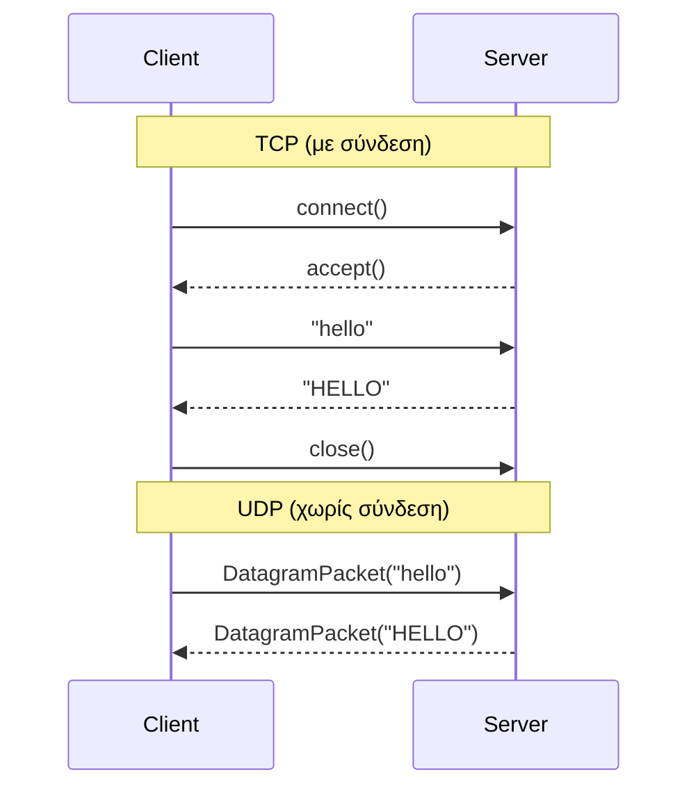

# 🌐 Δικτυακός Προγραμματισμός — Σημειώσεις & Παραδείγματα Κώδικα


Παραδείγματα κώδικα σε **Java** για το μάθημα
[**Δικτυακός Προγραμματισμός** (HMMY105)](https://eclass.uowm.gr/courses/HMMY105/)
του **Τμήματος Ηλεκτρολόγων Μηχανικών και Μηχανικών Υπολογιστών (ΗΜΜΥ)** του
**Πανεπιστημίου Δυτικής Μακεδονίας**, Ακαδημαϊκό Εξάμηνο **2026–2027**.

Τα παραδείγματα καλύπτουν τα βασικά της επικοινωνίας client–server με **TCP** και **UDP sockets**,
καθώς και τη χρήση **νημάτων (threads)** για την ταυτόχρονη εξυπηρέτηση πολλών πελατών.

> 📖 Τα παραδείγματα με τα Sockets ([`tcp_sockets`](tcp_sockets) και [`udp_sockets`](udp_sockets)) βασίζονται στο βιβλίο
> **J.F. Kurose, K.W. Ross — *Computer Networking: A Top-Down Approach*** (βλ. [Βιβλιογραφία](#-βιβλιογραφία)).

---

## 📂 Περιεχόμενα

| Φάκελος | Θέμα | Πρωτόκολλο | Θύρα | Αρχεία |
|---|---|:---:|:---:|---|
| [`tcp_sockets`](tcp_sockets) | Μετατροπή κειμένου σε κεφαλαία | TCP | `6789` | `TCPServer.java`, `TCPClient.java` |
| [`udp_sockets`](udp_sockets) | Μετατροπή κειμένου σε κεφαλαία | UDP | `9876` | `UDPServer.java`, `UDPClient.java` |
| [`threadsexample`](threadsexample) | Εισαγωγή στα νήματα (`Runnable`) | — | — | `MyThread.java`, `ThreadRunnable.java` |
| [`EchoClientTCP`](EchoClientTCP) | Πολυνηματικός Echo Server | TCP | `8205` | `EchoServer.java`, `EchoClient.java` |
| [`TimeClientServerUDP`](TimeClientServerUDP) | Υπηρεσία ώρας (Time Server) | UDP | `8505` | `TimeServer.java`, `TimeClient.java` |

> Προτεινόμενη σειρά μελέτης: `tcp_sockets` → `udp_sockets` → `threadsexample` → `EchoClientTCP` → `TimeClientServerUDP`

---

## 📘 Περιγραφή Παραδειγμάτων

### 1. TCP Sockets — [`tcp_sockets`](tcp_sockets)
Ο **`TCPServer`** ανοίγει ένα `ServerSocket` στη θύρα `6789` και περιμένει συνδέσεις.
Για κάθε πελάτη διαβάζει μία γραμμή κειμένου, τη μετατρέπει σε **κεφαλαία** και την επιστρέφει.
Ο **`TCPClient`** συνδέεται στο `localhost`, στέλνει μια γραμμή που πληκτρολογεί ο χρήστης και τυπώνει την απάντηση.

**Έννοιες:** `ServerSocket`, `Socket`, `accept()`, `BufferedReader`, `DataOutputStream`, επαναληπτικός (iterative) server.

### 2. UDP Sockets — [`udp_sockets`](udp_sockets)
Η ίδια λειτουργία με το παράδειγμα TCP, αλλά **χωρίς σύνδεση** (connectionless).
Ο **`UDPServer`** ακούει στη θύρα `9876`, λαμβάνει ένα datagram, απαντά με το κείμενο σε κεφαλαία
στη διεύθυνση/θύρα του αποστολέα. Ο **`UDPClient`** στέλνει ένα πακέτο και περιμένει την απάντηση.

**Έννοιες:** `DatagramSocket`, `DatagramPacket`, `send()` / `receive()`, `InetAddress`, buffers από `byte[]`.

### 3. Νήματα — [`threadsexample`](threadsexample)
Η **`ThreadRunnable`** υλοποιεί το interface `Runnable` και τυπώνει έναν μετρητή από 1 έως 100.
Η **`MyThread`** δημιουργεί **δύο νήματα** (`Thread1`, `Thread2`) με το ίδιο αντικείμενο `Runnable`
και τα ξεκινά — στην έξοδο φαίνεται η **παρεμβολή (interleaving)** της εκτέλεσής τους.

**Έννοιες:** `Runnable`, `Thread`, `start()` vs `run()`, `Thread.currentThread().getName()`.

### 4. Πολυνηματικός Echo Server — [`EchoClientTCP`](EchoClientTCP)
Ο **`EchoServer`** ακούει στη θύρα `8205` και για **κάθε** νέα σύνδεση δημιουργεί ένα νέο νήμα
`EchoThread`, ώστε να εξυπηρετεί **πολλούς πελάτες ταυτόχρονα**. Κάθε γραμμή που λαμβάνει
επιστρέφεται ως `Received: <κείμενο>`. Η εντολή `quit` τερματίζει τη συνεδρία.
Ο **`EchoClient`** διαβάζει συνεχώς από το πληκτρολόγιο, στέλνει στον server και τυπώνει την απάντηση.

**Έννοιες:** concurrent server, ένα νήμα ανά πελάτη, `extends Thread`, `try / finally` για κλείσιμο socket.

### 5. UDP Time Server — [`TimeClientServerUDP`](TimeClientServerUDP)
Ο **`TimeServer`** ακούει στη θύρα `8505`. Όταν λάβει οποιοδήποτε datagram, απαντά με την τρέχουσα
ημερομηνία/ώρα του server (μορφή `ημ/μήνας/έτος-ώρα:λεπτά:δευτ.`).
Ο **`TimeClient`** στέλνει ένα αίτημα και τυπώνει την ώρα που επέστρεψε ο server.

**Έννοιες:** request/response πάνω από UDP, `Calendar`, μετατροπή `byte[]` ↔ `String`.

---

## 🔁 TCP vs UDP με μια ματιά



| | TCP | UDP |
|---|---|---|
| Σύνδεση | Ναι (connection-oriented) | Όχι (connectionless) |
| Αξιοπιστία | Εγγυημένη παράδοση & σειρά | Χωρίς εγγυήσεις |
| Κλάσεις Java | `ServerSocket`, `Socket` | `DatagramSocket`, `DatagramPacket` |
| Μονάδα δεδομένων | Ροή (stream) | Πακέτο (datagram) |

---

## ▶️ Εκτέλεση

### Προαπαιτούμενα
- **JDK 8** ή νεότερο (`java -version`)
- Προαιρετικά ένα IDE όπως **Eclipse** ή **IntelliJ IDEA**

### Από τη γραμμή εντολών
Τα αρχεία δεν ανήκουν σε κάποιο `package`, οπότε μεταγλωττίζονται απευθείας μέσα στον φάκελό τους.
Ξεκινήστε **πρώτα τον server** και μετά τον client, σε **ξεχωριστά τερματικά**.

```bash
# Τερματικό 1 — Server
cd tcp_sockets
javac *.java
java TCPServer

# Τερματικό 2 — Client
cd tcp_sockets
java TCPClient
```

Με τον ίδιο τρόπο τρέχουν και τα υπόλοιπα ζεύγη:

| Παράδειγμα | Server | Client |
|---|---|---|
| `tcp_sockets` | `java TCPServer` | `java TCPClient` |
| `udp_sockets` | `java UDPServer` | `java UDPClient` |
| `EchoClientTCP` | `java EchoServer` | `java EchoClient` |
| `TimeClientServerUDP` | `java TimeServer` | `java TimeClient` |
| `threadsexample` | `java MyThread` | — |

> 💡 Για να δείτε τον πολυνηματικό `EchoServer` σε δράση, ανοίξτε **δύο ή περισσότερους** `EchoClient` ταυτόχρονα.
## 📖 Βιβλιογραφία
- J.F. Kurose, K.W. Ross, ***Computer Networking: A Top-Down Approach***, Pearson.
  Τα παραδείγματα TCP και UDP sockets (`TCPClient`/`TCPServer`, `UDPClient`/`UDPServer`) βασίζονται
  στα αντίστοιχα παραδείγματα του κεφαλαίου για τον προγραμματισμό sockets (Application Layer).

---

## 🔗 Χρήσιμοι Σύνδεσμοι
- 📚 [Σελίδα μαθήματος στο eClass (HMMY105)](https://eclass.uowm.gr/courses/HMMY105/)
- ☕ [Oracle Java Tutorials — All About Sockets](https://docs.oracle.com/javase/tutorial/networking/sockets/index.html)
- ☕ [Oracle Java Tutorials — All About Datagrams](https://docs.oracle.com/javase/tutorial/networking/datagrams/index.html)
- ☕ [Oracle Java Tutorials — Concurrency](https://docs.oracle.com/javase/tutorial/essential/concurrency/index.html)

---

<sub>Τμήμα Ηλεκτρολόγων Μηχανικών και Μηχανικών Υπολογιστών · Πανεπιστήμιο Δυτικής Μακεδονίας · 2026–2027</sub>
