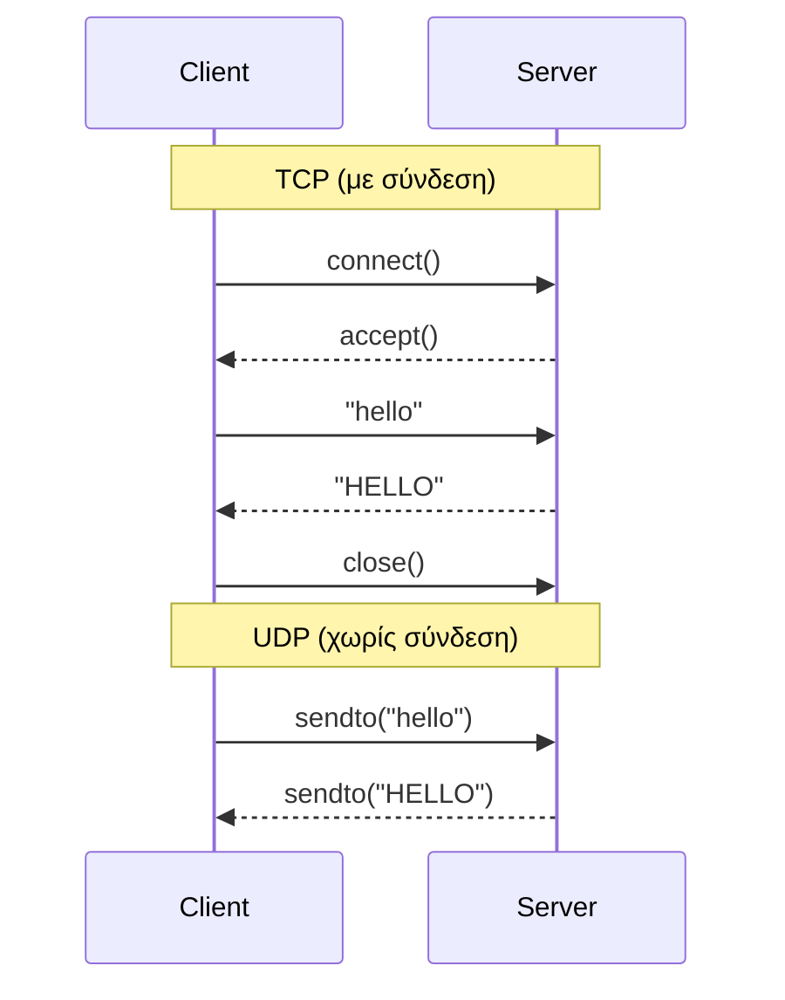

# 🌐 Δικτυακός Προγραμματισμός — Σημειώσεις & Παραδείγματα Κώδικα


Παραδείγματα κώδικα σε **Java** και **Python** για το μάθημα
[**Δικτυακός Προγραμματισμός** (HMMY105)](https://eclass.uowm.gr/courses/HMMY105/)
με καθηγητή τον κ. Άγγελο Μιχάλα του **Τμήματος Ηλεκτρολόγων Μηχανικών και Μηχανικών Υπολογιστών (ΗΜΜΥ)** του
**Πανεπιστημίου Δυτικής Μακεδονίας**, Ακαδημαϊκό Εξάμηνο 2026–2027.

Τα παραδείγματα καλύπτουν τα βασικά της επικοινωνίας client–server με **TCP** και **UDP sockets**,
καθώς και τη χρήση **νημάτων (threads)** για την ταυτόχρονη εξυπηρέτηση πολλών πελατών.

> 📖 Τα βασικά παραδείγματα TCP και UDP Sockets (σε Java και Python) βασίζονται στο βιβλίο
> **J.F. Kurose, K.W. Ross — *Computer Networking: A Top-Down Approach*** (βλ. [Βιβλιογραφία](https://ebooks.karbust.me/Technology/Computer%20Networking%20A%20Top-Down%20Approach,%208th%20Edition%20by%20James%20F.%20Kurose,%20Keith%20W.%20Ross-Pearson-9780136681557.pdf)).

---

## 📂 Δομή Αποθετηρίου

```
WebProgECE/
├── Lecture_Java-Sockets_and_Threads/
│   ├── tcp_sockets/            TCPServer.java, TCPClient.java
│   ├── udp_sockets/            UDPServer.java, UDPClient.java
│   ├── threadsexample/         MyThread.java, ThreadRunnable.java
│   ├── EchoClientTCP/          EchoServer.java, EchoClient.java
│   ├── TimeClientServerUDP/    TimeServer.java, TimeClient.java
│   └── requirements.sh         Εγκατάσταση JDK 25 σε Ubuntu / WSL
├── Lecture_Python-Sockets_and_Threads/
│   ├── TCP_Sockets/            TCPServer.py, TCPClient.py
│   ├── UDP_Sockets/            UDPServer.py, UDPClient.py
│   └── Threads_and_Sockets/    Server.py, client.py
├── Lecture_JavaScript/
│   └── Form-Example/           index.html, styles.css, script.js
├── LICENSE
└── README.md
```

---

## ☕ Διάλεξη: Java — Sockets και Threads

📁 [`Lecture_Java-Sockets_and_Threads`](Lecture_Java-Sockets_and_Threads)

| Φάκελος | Θέμα | Πρωτόκολλο | Θύρα | Αρχεία |
|---|---|:---:|:---:|---|
| [`tcp_sockets`](Lecture_Java-Sockets_and_Threads/tcp_sockets) | Μετατροπή κειμένου σε κεφαλαία | TCP | `6789` | `TCPServer.java`, `TCPClient.java` |
| [`udp_sockets`](Lecture_Java-Sockets_and_Threads/udp_sockets) | Μετατροπή κειμένου σε κεφαλαία | UDP | `9876` | `UDPServer.java`, `UDPClient.java` |
| [`threadsexample`](Lecture_Java-Sockets_and_Threads/threadsexample) | Εισαγωγή στα νήματα (`Runnable`) | — | — | `MyThread.java`, `ThreadRunnable.java` |
| [`EchoClientTCP`](Lecture_Java-Sockets_and_Threads/EchoClientTCP) | Πολυνηματικός Echo Server | TCP | `8205` | `EchoServer.java`, `EchoClient.java` |
| [`TimeClientServerUDP`](Lecture_Java-Sockets_and_Threads/TimeClientServerUDP) | Υπηρεσία ώρας (Time Server) | UDP | `8505` | `TimeServer.java`, `TimeClient.java` |

> Προτεινόμενη σειρά μελέτης: `tcp_sockets` → `udp_sockets` → `threadsexample` → `EchoClientTCP` → `TimeClientServerUDP`

### 1. TCP Sockets — [`tcp_sockets`](Lecture_Java-Sockets_and_Threads/tcp_sockets)
Ο **`TCPServer`** ανοίγει ένα `ServerSocket` στη θύρα `6789` και περιμένει συνδέσεις.
Για κάθε πελάτη διαβάζει μία γραμμή κειμένου, τη μετατρέπει σε **κεφαλαία** και την επιστρέφει.
Ο **`TCPClient`** συνδέεται στο `localhost`, στέλνει μια γραμμή που πληκτρολογεί ο χρήστης και τυπώνει την απάντηση.

**Έννοιες:** `ServerSocket`, `Socket`, `accept()`, `BufferedReader`, `DataOutputStream`, επαναληπτικός (iterative) server.

### 2. UDP Sockets — [`udp_sockets`](Lecture_Java-Sockets_and_Threads/udp_sockets)
Η ίδια λειτουργία με το παράδειγμα TCP, αλλά **χωρίς σύνδεση** (connectionless).
Ο **`UDPServer`** ακούει στη θύρα `9876`, λαμβάνει ένα datagram, απαντά με το κείμενο σε κεφαλαία
στη διεύθυνση/θύρα του αποστολέα. Ο **`UDPClient`** στέλνει ένα πακέτο και περιμένει την απάντηση.

**Έννοιες:** `DatagramSocket`, `DatagramPacket`, `send()` / `receive()`, `InetAddress`, buffers από `byte[]`.

### 3. Νήματα — [`threadsexample`](Lecture_Java-Sockets_and_Threads/threadsexample)
Η **`ThreadRunnable`** υλοποιεί το interface `Runnable` και τυπώνει έναν μετρητή από 1 έως 100.
Η **`MyThread`** δημιουργεί **δύο νήματα** (`Thread1`, `Thread2`) με το ίδιο αντικείμενο `Runnable`
και τα ξεκινά — στην έξοδο φαίνεται η **παρεμβολή (interleaving)** της εκτέλεσής τους.

**Έννοιες:** `Runnable`, `Thread`, `start()` vs `run()`, `Thread.currentThread().getName()`.

### 4. Πολυνηματικός Echo Server — [`EchoClientTCP`](Lecture_Java-Sockets_and_Threads/EchoClientTCP)
Ο **`EchoServer`** ακούει στη θύρα `8205` και για **κάθε** νέα σύνδεση δημιουργεί ένα νέο νήμα
`EchoThread`, ώστε να εξυπηρετεί **πολλούς πελάτες ταυτόχρονα**. Κάθε γραμμή που λαμβάνει
επιστρέφεται ως `Received: <κείμενο>`. Η εντολή `quit` τερματίζει τη συνεδρία.
Ο **`EchoClient`** διαβάζει συνεχώς από το πληκτρολόγιο, στέλνει στον server και τυπώνει την απάντηση.

**Έννοιες:** concurrent server, ένα νήμα ανά πελάτη, `extends Thread`, `try / finally` για κλείσιμο socket.

### 5. UDP Time Server — [`TimeClientServerUDP`](Lecture_Java-Sockets_and_Threads/TimeClientServerUDP)
Ο **`TimeServer`** ακούει στη θύρα `8505`. Όταν λάβει οποιοδήποτε datagram, απαντά με την τρέχουσα
ημερομηνία/ώρα του server (μορφή `ημ/μήνας/έτος-ώρα:λεπτά:δευτ.` σε 24ωρη μορφή, π.χ. `24/10/2026-20:05:09`).
Ο **`TimeClient`** στέλνει ένα αίτημα και τυπώνει την ώρα που επέστρεψε ο server.

**Έννοιες:** request/response πάνω από UDP, `Calendar`, μετατροπή `byte[]` ↔ `String`.

---

## 🐍 Διάλεξη: Python — Sockets και Threads

📁 [`Lecture_Python-Sockets_and_Threads`](Lecture_Python-Sockets_and_Threads)

| Φάκελος | Θέμα | Πρωτόκολλο | Θύρα | Αρχεία |
|---|---|:---:|:---:|---|
| [`TCP_Sockets`](Lecture_Python-Sockets_and_Threads/TCP_Sockets) | Μετατροπή κειμένου σε κεφαλαία | TCP | `12000` | `TCPServer.py`, `TCPClient.py` |
| [`UDP_Sockets`](Lecture_Python-Sockets_and_Threads/UDP_Sockets) | Μετατροπή κειμένου σε κεφαλαία | UDP | `12000` | `UDPServer.py`, `UDPClient.py` |
| [`Threads_and_Sockets`](Lecture_Python-Sockets_and_Threads/Threads_and_Sockets) | Πολυνηματικός TCP server με μηνύματα | TCP | `5050` | `Server.py`, `client.py` |

### 1. TCP Sockets — [`TCP_Sockets`](Lecture_Python-Sockets_and_Threads/TCP_Sockets)
Ο **`TCPServer.py`** δημιουργεί ένα socket `AF_INET` / `SOCK_STREAM`, κάνει `bind()` στη θύρα `12000`
και `listen()`. Για κάθε σύνδεση λαμβάνει μια πρόταση, την επιστρέφει σε **κεφαλαία** και κλείνει τη σύνδεση.
Ο **`TCPClient.py`** συνδέεται στο `127.0.0.1:12000`, στέλνει την πρόταση του χρήστη και τυπώνει την απάντηση.

**Έννοιες:** `socket()`, `bind()`, `listen()`, `accept()`, `connect()`, `send()` / `recv()`, `encode()` / `decode()`.

### 2. UDP Sockets — [`UDP_Sockets`](Lecture_Python-Sockets_and_Threads/UDP_Sockets)
Η ίδια λειτουργία πάνω από **UDP** (`SOCK_DGRAM`). Ο **`UDPServer.py`** ακούει στο `127.0.0.1:12000`,
λαμβάνει ένα πακέτο με `recvfrom()` και απαντά με `sendto()` στη διεύθυνση του αποστολέα.
Ο **`UDPClient.py`** στέλνει ένα μήνυμα χωρίς να δημιουργήσει σύνδεση και τυπώνει την απάντηση.

**Έννοιες:** `SOCK_DGRAM`, `sendto()` / `recvfrom()`, διεύθυνση πελάτη `(IP, port)`.

### 3. Threads και Sockets — [`Threads_and_Sockets`](Lecture_Python-Sockets_and_Threads/Threads_and_Sockets)
Ο **`Server.py`** ακούει στη θύρα `5050` (στη διεύθυνση IP του υπολογιστή) και για κάθε νέο πελάτη
ξεκινά ένα νέο `threading.Thread`, ώστε να εξυπηρετεί **πολλούς πελάτες ταυτόχρονα**.
Χρησιμοποιεί ένα απλό **πρωτόκολλο εφαρμογής**: κάθε μήνυμα προηγείται από μια κεφαλίδα (header)
σταθερού μήκους 64 bytes που δηλώνει το μήκος του. Το μήνυμα `!DISCONNECT` τερματίζει τη σύνδεση.
Ο **`client.py`** στέλνει μερικά προκαθορισμένα μηνύματα (πατώντας Enter ανάμεσα), ένα μήνυμα του χρήστη και στο τέλος αποσυνδέεται.

**Έννοιες:** `threading.Thread`, `threading.active_count()`, πλαισίωση μηνυμάτων (message framing) με header μήκους, κωδικοποίηση `utf-8`.

> ⚠️ Στο `client.py` η μεταβλητή `SERVER` έχει μια συγκεκριμένη IP (`192.168.44.164`).
> Αλλάξτε τη στη διεύθυνση IP του υπολογιστή όπου τρέχει ο `Server.py` (τυπώνεται στο μήνυμα `[LISTENING]`).

---

## 🔁 TCP vs UDP με μια ματιά



| | TCP | UDP |
|---|---|---|
| Σύνδεση | Ναι (connection-oriented) | Όχι (connectionless) |
| Αξιοπιστία | Εγγυημένη παράδοση & σειρά | Χωρίς εγγυήσεις |
| Java | `ServerSocket`, `Socket` | `DatagramSocket`, `DatagramPacket` |
| Python | `socket(AF_INET, SOCK_STREAM)` | `socket(AF_INET, SOCK_DGRAM)` |
| Μονάδα δεδομένων | Ροή (stream) | Πακέτο (datagram) |

---

## ▶️ Εκτέλεση

Ξεκινήστε **πάντα πρώτα τον server** και μετά τον client, σε **ξεχωριστά τερματικά**.
Κάθε server τυπώνει όταν ξεκινά τη θύρα στην οποία ακούει, και σταματά με **Ctrl+C**.
Οι clients τυπώνουν οδηγίες όταν περιμένουν να πληκτρολογήσετε κάτι.

### Java
**Προαπαιτούμενα:** **JDK 8** ή νεότερο (`java -version` και `javac -version`), προαιρετικά ένα IDE όπως **Eclipse** ή **IntelliJ IDEA**.
Σε **Ubuntu / WSL** το JDK εγκαθίσταται με το script [`requirements.sh`](Lecture_Java-Sockets_and_Threads/requirements.sh),
που εγκαθιστά το **OpenJDK 25** (LTS):

```bash
cd Lecture_Java-Sockets_and_Threads
bash requirements.sh
```

Τα αρχεία δεν ανήκουν σε κάποιο `package`, οπότε μεταγλωττίζονται απευθείας μέσα στον φάκελό τους.

> ⚠️ Τα σχόλια του κώδικα είναι στα ελληνικά και τα αρχεία είναι αποθηκευμένα σε **UTF-8**.
> Αν σε Windows η `javac` εμφανίσει σφάλμα `unmappable character`, μεταγλωττίστε με
> `javac -encoding UTF-8 *.java` (από τη Java 18 και μετά το UTF-8 είναι η προεπιλογή).

```bash
# Τερματικό 1 — Server
cd Lecture_Java-Sockets_and_Threads/tcp_sockets
javac *.java
java TCPServer

# Τερματικό 2 — Client
cd Lecture_Java-Sockets_and_Threads/tcp_sockets
java TCPClient
```

| Παράδειγμα | Server | Client |
|---|---|---|
| `tcp_sockets` | `java TCPServer` | `java TCPClient` |
| `udp_sockets` | `java UDPServer` | `java UDPClient` |
| `EchoClientTCP` | `java EchoServer` | `java EchoClient` |
| `TimeClientServerUDP` | `java TimeServer` | `java TimeClient` |
| `threadsexample` | `java MyThread` | — |

> 💡 Για να δείτε τον πολυνηματικό `EchoServer` σε δράση, ανοίξτε **δύο ή περισσότερους** `EchoClient` ταυτόχρονα.

### Python
**Προαπαιτούμενα:** **Python 3** (`python --version`). Δεν χρειάζονται εξωτερικές βιβλιοθήκες.

```bash
# Τερματικό 1 — Server
cd Lecture_Python-Sockets_and_Threads/TCP_Sockets
python TCPServer.py

# Τερματικό 2 — Client
cd Lecture_Python-Sockets_and_Threads/TCP_Sockets
python TCPClient.py
```

| Παράδειγμα | Server | Client |
|---|---|---|
| `TCP_Sockets` | `python TCPServer.py` | `python TCPClient.py` |
| `UDP_Sockets` | `python UDPServer.py` | `python UDPClient.py` |
| `Threads_and_Sockets` | `python Server.py` | `python client.py` |

> 💡 Στο `Threads_and_Sockets` ανοίξτε **πολλούς** `client.py` για να δείτε τον μετρητή `[ACTIVE CONNECTIONS]` να αυξάνεται.

---

## 🐳 Διάλεξη: Docker

Στη διάλεξη αυτή θα ασχοληθούμε με **Docker** και **Docker Compose**, με βάση το αποθετήριο
[**WebServer-Dockers-ECE**](https://github.com/chitiris/WebServer-Dockers-ECE).
Το αποθετήριο αυτό στήνει με containers ένα πλήρες περιβάλλον ανάπτυξης web εφαρμογών:

| Υπηρεσία | Ρόλος |
|---|---|
| **Nginx** | Web server |
| **PHP** | Εκτέλεση server-side κώδικα |
| **MySQL** | Βάση δεδομένων |
| **phpMyAdmin** | Διαχείριση της βάσης μέσω browser |

**Προετοιμασία πριν από τη διάλεξη:** εγκαταστήστε το [Docker Desktop](https://www.docker.com/products/docker-desktop/)
(σε Windows με το WSL 2 backend) και ακολουθήστε τις οδηγίες του README του αποθετηρίου.

---

## 🎨 Διάλεξη: HTML και CSS

Η διάλεξη βασίζεται στο αποθετήριο [**Netlify-ece-example**](https://github.com/chitiris/Netlify-ece-example),
μια στατική σελίδα portfolio που φτιάχνεται με **HTML** και **CSS** και δημοσιεύεται στο **Netlify**.

🌐 **Live:** [ecedemo.netlify.app](https://ecedemo.netlify.app/)

| Αρχείο | Ρόλος |
|---|---|
| `index.html` | Η δομή της σελίδας: ενότητες, λίστες, εικόνες και φόρμα επικοινωνίας |
| `styles.css` | Η εμφάνιση: χρώματα, γραμματοσειρές, διάταξη |
| `formValidation.js` | Έλεγχος των πεδίων της φόρμας πριν από την υποβολή |

**Έννοιες:** σημασιολογικά tags (`header`, `section`, `footer`), φόρμες, επιλογείς CSS (id, attribute, `:hover`), media queries για responsive σχεδίαση, δημοσίευση στατικού site στο Netlify.

---

## 🟨 Διάλεξη: JavaScript

📁 [`Lecture_JavaScript`](Lecture_JavaScript)

| Φάκελος | Θέμα | Αρχεία |
|---|---|---|
| [`Form-Example`](Lecture_JavaScript/Form-Example) | Φόρμα επικοινωνίας με έλεγχο πεδίων (validation) | `index.html`, `styles.css`, `script.js` |

### 1. Φόρμα επικοινωνίας — [`Form-Example`](Lecture_JavaScript/Form-Example)
Μια responsive φόρμα με πεδία **Όνομα**, **Email** και **Μήνυμα**. Πριν από την υποβολή, το **`script.js`**
ελέγχει ότι όλα τα πεδία είναι συμπληρωμένα και ότι το email έχει σωστή μορφή, με μια κανονική έκφραση
(regular expression) που εξηγείται βήμα-βήμα στα σχόλια του κώδικα.

**Έννοιες:** `addEventListener('submit', …)`, `event.preventDefault()`, `trim()`, regular expressions, `form.reset()`.

**Εκτέλεση:** ανοίξτε το `index.html` σε έναν browser. Δεν χρειάζεται εγκατάσταση ή server.

---

## 📖 Βιβλιογραφία
- J.F. Kurose, K.W. Ross, ***Computer Networking: A Top-Down Approach***, Pearson.
  Τα παραδείγματα TCP και UDP sockets — σε Java (`tcp_sockets`, `udp_sockets`) και σε Python (`TCP_Sockets`, `UDP_Sockets`) —
  βασίζονται στα αντίστοιχα παραδείγματα του κεφαλαίου για τον προγραμματισμό sockets (Application Layer).

---

## 🔗 Χρήσιμοι Σύνδεσμοι
- 📚 [Σελίδα μαθήματος στο eClass (HMMY105)](https://eclass.uowm.gr/courses/HMMY105/)
- 🐳 [WebServer-Dockers-ECE — Διάλεξη: Docker](https://github.com/chitiris/WebServer-Dockers-ECE)
- ☕ [Oracle Java Tutorials — All About Sockets](https://docs.oracle.com/javase/tutorial/networking/sockets/index.html)
- ☕ [Oracle Java Tutorials — All About Datagrams](https://docs.oracle.com/javase/tutorial/networking/datagrams/index.html)
- ☕ [Oracle Java Tutorials — Concurrency](https://docs.oracle.com/javase/tutorial/essential/concurrency/index.html)
- 🐍 [Python Docs — `socket` — Low-level networking interface](https://docs.python.org/3/library/socket.html)
- 🐍 [Python Docs — Socket Programming HOWTO](https://docs.python.org/3/howto/sockets.html)
- 🐍 [Python Docs — `threading` — Thread-based parallelism](https://docs.python.org/3/library/threading.html)
- 🎨 [Netlify-ece-example — Διάλεξη: HTML και CSS](https://github.com/chitiris/Netlify-ece-example) · [🌐 Live](https://ecedemo.netlify.app/)
- 🟨 [MDN — Client-side form validation](https://developer.mozilla.org/en-US/docs/Learn_web_development/Extensions/Forms/Form_validation)

---

## 📄 Άδεια Χρήσης
Διατίθεται υπό την άδεια [MIT](LICENSE) — © 2026 Christos Hitiris.

---

<sub>Τμήμα Ηλεκτρολόγων Μηχανικών και Μηχανικών Υπολογιστών · Πανεπιστήμιο Δυτικής Μακεδονίας · 2026–2027</sub>
